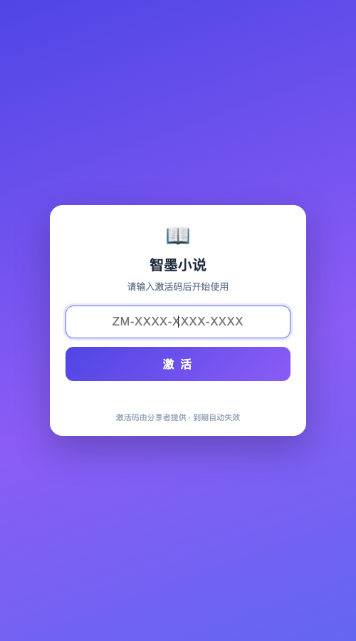
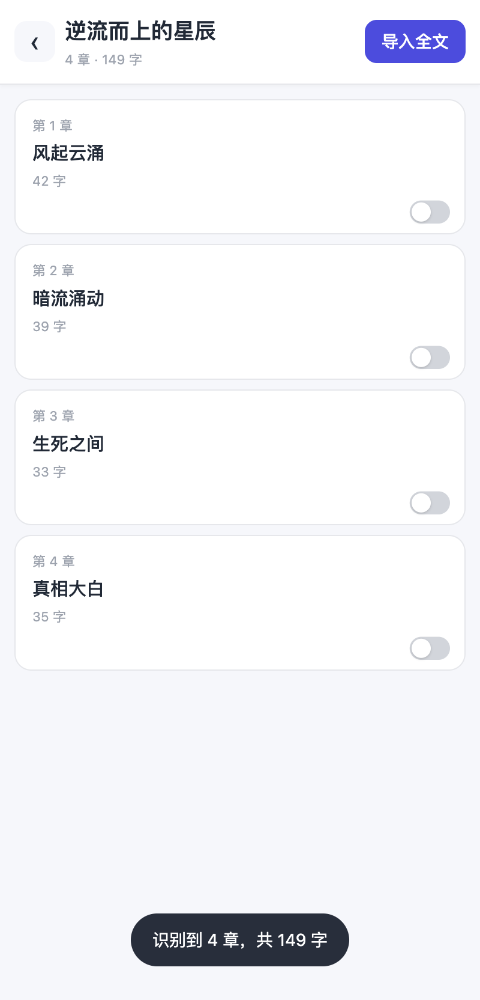
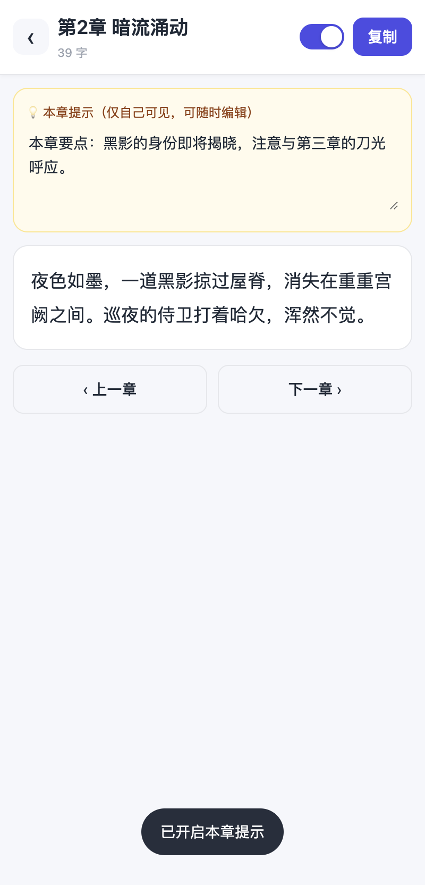
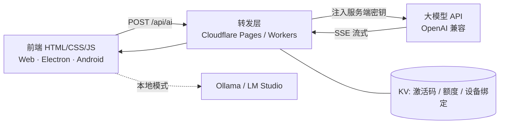

# 智墨小说 · AI 小说创作助手

一个可以直接装上手机用的 AI 写作工具：输入一句话生成世界观、人物设定与章节正文，支持续写 / 改写 / 扩写，带上下文记忆与本地章节管理。

从 0 到上线由我独立完成 —— 需求拆解、Prompt 设计、前后端、Android 打包、在线更新链路、激活与额度体系。本项目用于展示工程实现，**仓库内不含任何密钥、签名文件与用户数据**。





---

## 一、它解决什么问题

写网文最耗时的不是"想不出来"，而是三件事：设定越写越乱、每次续写都要重新交代背景、长章节一次生成不完。

这个工具的做法是把长篇拆成可维护的三层上下文，再用"设定常驻 + 近期原文 + 早期摘要"喂给模型，让它在几十万字之后还记得主角叫什么、上一章埋了什么伏笔。

## 二、功能

| 模块 | 说明 |
|---|---|
| 作品设定 | 世界观、角色卡、写作风格，一次生成后可反复微调，作为全局上下文常驻 |
| 章节创作 | 一键生成整章 / 指定字数续写 / 选中段落改写扩写 |
| 上下文记忆 | 章节要点 + 摘要压缩，跨章节保持人物与情节一致 |
| 章节管理 | 本地存储、自动保存、字数统计、上一章 / 下一章快速切换 |
| 模型接入 | 智谱 GLM、任意 OpenAI 兼容接口、本地 Ollama / LM Studio |
| 多端 | 浏览器、macOS 桌面（Electron）、Android（WebView 容器） |
| 分发 | 安装包在线更新（版本清单 + MD5 校验）、激活码 + 设备绑定 |

## 三、技术架构



关键设计：**客户端不持有任何密钥**。App 里只有一个转发地址，API Key 存在服务端环境变量里，就算把 APK 拆开也拿不到 Key。

### 目录

```
web/        网页源码（唯一数据源，浏览器直接可跑）
mobile/     手机端产物：由 web/ 构建注入，差异集中在 lock-ui.js / mobile.css / app-update.js
electron/   桌面壳：本地服务器 + 跨域桥接
android/    Android 容器：Gradle 打包、签名配置、WebView 宿主
proxy/      服务端：模型转发 + 激活校验（Cloudflare Worker / Pages）
docs/       截图与架构说明
```

## 四、几个实现细节

**1. 三层 Prompt 结构**
`世界观设定` + `人物卡` + `当前章节摘要` 分别拼进 system / 前置消息，改"每次重写整本书"为"增量维护上下文"，减少人设崩坏。

**2. token 预算裁剪**
发请求前按优先级压缩历史：设定永远保留 → 最近正文全留 → 早期对话压成摘要 → 低价值闲聊直接丢弃。避免超出模型窗口导致整次请求失败。

**3. 流式输出与分段续写**
SSE 逐块解析 `delta.content` 边收边渲染，把等待时间从"整段生成完才出字"变成首字即出；超长章节按段落切分多次生成再拼接。

**4. 在线更新链路**
服务端 `update.json` 携带 `versionCode / md5 / url`；App 启动比对 MD5，不一致就下载并拉起系统安装器，无需应用商店审核。

**5. 一套代码多端复用**
网页源码直接跑浏览器；Electron 起本地服务器解决 Ollama 跨域；Android 用 WebView 容器 + 资源内置，三端共用同一份 JS。

## 五、本地运行

```bash
# 1) 起一个静态服务器（不要用 file:// 打开，会触发跨域）
python3 -m http.server 8080

# 2) 浏览器打开 http://127.0.0.1:8080
#    在「设置」里填 API 地址与 Key（本地自用可直连；对外发布请走 proxy/）
```

服务端（可选，用于隐藏密钥）：

```bash
cd proxy
# 把 worker.js 部署到你自己的 Cloudflare Worker，配置环境变量：
#   API_KEY        大模型 API Key
#   ADMIN_TOKEN    管理口令
# 再把 pages-router.js 的 UPSTREAM 改成你的 Worker 地址后部署为 Pages 静态代理
```

## 六、说明

- 本仓库为**展示用途的脱敏版本**：不含 APK 二进制、签名密钥、Cloudflare 账号与 KV 命名空间 ID、激活码数据、一键部署脚本。
- `proxy/worker.js` 中的激活码校验逻辑保留，用于说明"设备绑定 + 额度"的实现方式；其中的 KV ID、上游地址均已替换为占位符。
- 截图中的作品内容为演示数据。

## 七、关于

个人独立项目，完整实现（前端、桌面端、Android 容器、模型转发与授权）均由作者一人完成。
本仓库只开源作品本身，不包含任何个人身份信息、简历或联系方式；技术交流请通过 GitHub Issues 或账号主页。
